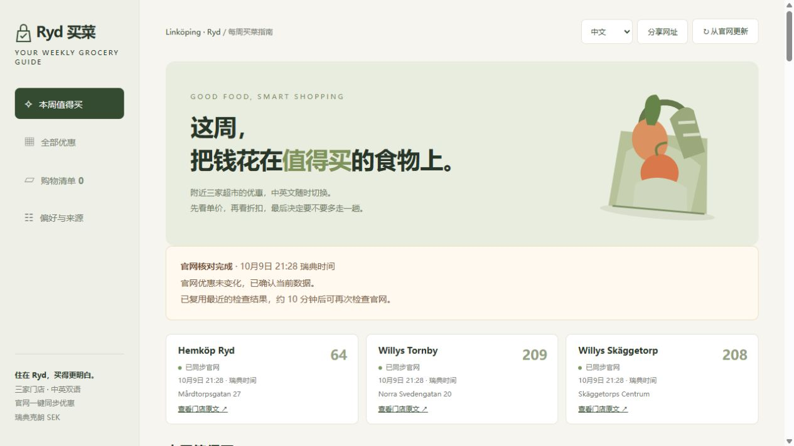

# Ryd Weekly Deals · Ryd 每周买菜指南

[](https://github.com/wwwzyccc777/ryd-weekly-deals/actions/workflows/ci.yml)


**林雪平三家超市的每周优惠，中文 / English 双语，一键同步官网，按单价筛选值得买的食材。**

[直接使用网页版](https://ryd-weekly-deals.shadyloom16.chatgpt.site) · [English website](https://ryd-weekly-deals.shadyloom16.chatgpt.site/?lang=en) · [部署指南](docs/DEPLOYMENT.md) · [参与贡献](CONTRIBUTING.md)



## 功能

- 汇总 Hemköp Linköping Ryd（4193）、Willys Linköping Tornby（2298）、Willys Linköping Skäggetorp（2178）的门店官网优惠。
- 公开网页免登录；任何人点击“从官网更新”，云端抓取、翻译并保存，访客共享最新数据。无需维护者电脑开机。
- 中文、英语与瑞典语原文对照。会员价、凑单、数量、押金、限购及有效日期单独标注。
- 按官方单价和节省金额给出可解释建议；同款 Willys 优惠合并，购物清单和偏好保存在各自浏览器。
- 官方商品图片、加载提示与缺图占位；支持搜索、分类、门店筛选与清单导出。
- R2 持久存储、并发锁、全站 10 分钟同步冷却；未变化会提示，失败保留并标记旧数据。

## 快速开始

安装 **Node.js 24+**，下载本项目 ZIP 并解压，Windows 双击 `Start.cmd`。或使用 Git：

```bash
git clone https://github.com/wwwzyccc777/ryd-weekly-deals.git
cd ryd-weekly-deals
npm run dev
```

打开 **http://127.0.0.1:8787**。没有第三方 npm 依赖，无需 `npm install`。本地模式直接采集，使用内存缓存；官网不可访问时显示标记失败的历史快照。公开在线网站使用 R2 持久保存，二者不同。

```bash
npm run build  # 由 src/ 和 data/ 生成 worker/index.js 及 dist/
npm test       # 价格、会员、有效期、双语、签名、存储及云端同步验证
npm run validate
```

分享给朋友只需要网页版链接。自行部署需要自己的 Worker / Sites 和 R2 存储，见 [部署指南](docs/DEPLOYMENT.md)。GitHub Pages 静态托管不能单独执行此项目的服务端采集。

## 数据与推荐

优先使用维护的中英文词库；新商品尝试机器翻译，失败保留瑞典语原文。推荐阈值是筛选规则，不是市场均价或历史最低价。个人专属券、实时库存不在采集范围内，购买前应核对官方商品与条件。

周优惠常按周一至周日有效，也有周四与跨周促销；有效期不等于官网精确发布时间，不承诺周一 00:00 已发布。同步按钮检查当时官网数据。仓库内快照来自 **2026-10-09**，不是实时价格。

当前演示站的独立云端定时任务因账号任务名额已满而未启用；一键云端同步正常运行。自行托管可调用 `/api/deals?checkSource=1` 做定时检查，具体行为见 [UPDATES.md](UPDATES.md)。托管免费额度与任务名额依赖平台和账号。

## 项目结构

```text
src/                 网页、解析、推荐、云端同步和签名验证
data/                审核词库及带真实时间的初始快照
scripts/             构建、本地预览、打包与测试
worker/              构建生成的 Worker（不提交）
docs/                部署说明及预览图
.github/workflows/   自动构建与测试
wrangler.jsonc       自行部署到 Cloudflare 的配置示例
```

## English

A bilingual grocery-deals website for three stores in Linköping, Sweden. Visitors can sync official offers in the cloud without an account or the maintainer's computer. It includes reviewed Chinese / English translations, Swedish originals, clear membership and purchase conditions, official images, shopping lists, and explainable unit-price recommendations.

**Run locally:** install Node.js 24+, clone or unzip, run `npm run dev`, then open http://127.0.0.1:8787. There are no npm dependencies. Local data is held in memory; dated snapshots are labelled when collection fails. For hosting, use your own Worker / Site with an R2 binding named `BUCKET`; see [deployment instructions](docs/DEPLOYMENT.md). Static GitHub Pages alone cannot run the collector.

**Develop:** `npm run build`, `npm test`, `npm run validate`. Python 3 is optional for `python scripts/package-source.py`, which prepares the website's source download. The build then embeds that archive.

The global sync cooldown is 10 minutes. Failed requests retain previous data. New translations can be unavailable; Swedish originals remain visible. Recommendations are screening rules, not historical-low claims. Snapshot prices are dated 2026-10-09. No guaranteed Monday-midnight publication time or live inventory is claimed.

## License

代码和作者整理的翻译词库使用 [MIT](LICENSE)。商家图片、商标和原始优惠信息保留各自权利；本项目不隶属于 Hemköp 或 Willys。

Code and authored translations are MIT licensed. Retailer images, trademarks and original promotion content retain their respective rights; see [NOTICE](NOTICE). Not affiliated with Hemköp or Willys.
